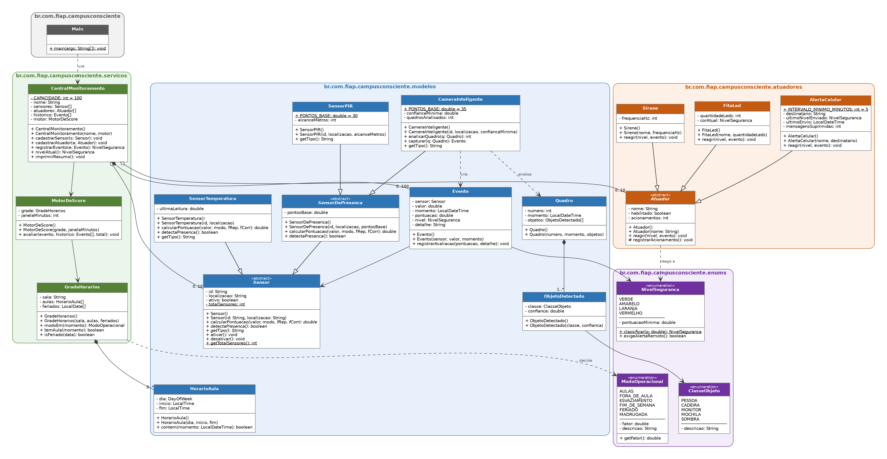

# Campus Consciente — Simulador em Java

Simulador orientado a objetos do **Campus Consciente**, sistema de segurança
patrimonial contextual do grupo **DataCore** (Challenge FIAP × Daten 2026).

## Como rodar no IntelliJ
1. **File → Open** → selecione a pasta `CampusConsciente`.
2. Se aparecer "Project JDK is not defined", clique em **Setup SDK** e escolha
   um JDK 17 ou mais novo.
3. Abra `src/br/com/fiap/campusconsciente/Main.java` e clique no ▶ verde.

## Pacotes
| Pacote | Conteúdo |
|---|---|
| `enums` | `NivelSeguranca`, `ModoOperacional`, `ClasseObjeto` |
| `modelos` | Sensores, visão computacional (`Quadro`, `ObjetoDetectado`), `Evento`, `HorarioAula` |
| `atuadores` | `FitaLed`, `Sirene`, `AlertaCelular` |
| `servicos` | `GradeHorarios`, `MotorDeScore`, `CentralMonitoramento` |

## Diagrama UML

